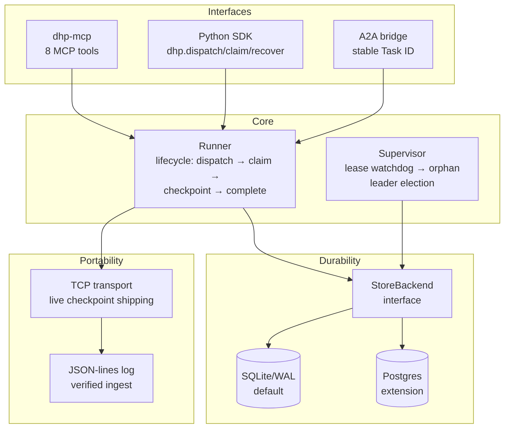

# DHP — Durable Handoff Protocol

[](https://pypi.org/project/dhp-protocol/)
[](https://pypi.org/project/dhp-protocol/)
[](LICENSE)
[]()
[]()

**Agent work that survives worker death.** When a worker is `kill -9`'d, OOM-killed, or its spot instance is reclaimed mid-run, DHP hands the work to a standby that resumes from the last checkpoint — zero rework, zero lost results.

MCP standardized agent↔tool. A2A standardized agent↔agent. **DHP is the missing layer: agent↔time** — execution state that outlives any single worker.

```bash
pip install dhp-protocol
```

**One-line install** (pip + MCP registration + data dir):

```bash
curl -fsSL https://raw.githubusercontent.com/SIDDARTHAREDDY8/dhp/main/install.sh | bash
```

**Direct into your agent:**

| Tool | Command |
|---|---|
| Claude Code | `claude mcp add dhp -- dhp-mcp --root ~/.dhp` |
| Cursor | [one-click install](https://cursor.com/en/install-mcp?name=dhp&config=eyJjb21tYW5kIjogImRocC1tY3AiLCAiYXJncyI6IFsiLS1yb290IiwgIn4vLmRocCJdfQ) |
| Windsurf / Zed | copy the JSON from [MCP_SETUP.md](MCP_SETUP.md) |
| Any MCP client | `dhp-mcp --root ~/.dhp` (stdio) |

**Other ways to run:** [Docker](Dockerfile) (`docker compose up -d` for
supervisor + transport server) · from source (`git clone` + `pip install -e ".[dev]"`)

---

## Table of Contents

- [The Problem](#the-problem)
- [What DHP Is](#what-dhp-is)
- [Five Guarantees](#five-guarantees)
- [Quickstart](#quickstart)
- [How It Works](#how-it-works)
- [The Kill Demo](#the-kill-demo)
- [Architecture](#architecture)
- [API Reference](#api-reference)
- [Measured Performance](#measured-performance)
- [Comparison](#comparison)
- [MCP & A2A Integration](#mcp--a2a-integration)
- [Roadmap](#roadmap)
- [Contributing](#contributing)
- [License](#license)

---

## The Problem

You delegate a 20-minute task to an AI agent. At minute 14, the process is killed — OOM, spot reclaim, deploy, laptop lid. **All 14 minutes of progress are gone.** The agent restarts from zero, redoes everything, burns tokens twice.

Every agent framework today has the same hole: **work is owned by the worker, not the handoff.** When the worker dies, the work dies with it. Retries start from scratch. There is no primitive for "this unit of work exists independently of whoever is executing it right now."

DHP is that primitive.

## What DHP Is

DHP (Durable Handoff Protocol) separates **work ownership** from **worker identity**:

- Work is dispatched as a **content-addressed handoff** — a durable record of intent (task, inputs, output schema, budget).
- Workers **claim** handoffs, hold **time-bounded leases**, and **checkpoint** progress as they go.
- A **supervisor** watches leases. A silent worker is declared dead in ~6 seconds; its handoff is **orphaned** and a monotonic **fence token** is bumped — the dead worker's late writes are rejected, so two workers can never both believe they own the work.
- Any **standby** recovers the orphaned handoff from the last checkpoint. **Zero rework.**
- Checkpoints ship over **TCP as they're made**, so if the entire host dies, the peer already has everything.

It composes with the existing stack rather than replacing it:

| Layer | Protocol | Concern |
|---|---|---|
| Tools | MCP | agent↔tool calls |
| Agents | A2A | agent↔agent messaging |
| **Durability** | **DHP** | **work survives worker death** |

## Five Guarantees

1. **No lost results** — every completed handoff's result is durable and retrievable.
2. **No crossed inputs** — handoff IDs are content-addressed over intent; inputs cannot be swapped mid-flight.
3. **No untyped results** — completions are validated against a JSON Schema before acceptance.
4. **No silent budget overrun** — hard caps on steps, spend, wall-clock, and attempts. Exhausted work parks in a dead-letter queue: intact, visible, never silently dropped.
5. **No runner lock-in** — suspend → ship → resume on any host, any runner. The wire format is plain JSON-lines.

## Quickstart

```python
import dhp

store = dhp.Store("./demo-dhp")

# 1. Dispatch durable work
hid = dhp.dispatch(
    store,
    task_kind="demo.count",
    inputs={"target": 50},
    output_schema={"type": "object",
                   "properties": {"counted": {"type": "integer"}},
                   "required": ["counted"]},
)

# 2. Work it — the context manager heartbeats automatically in the background
with dhp.claim(store, hid, worker_id="w1") as ctx:
    state = dhp.last_checkpoint(store, hid) or {"n": 0}
    while state["n"] < 50:
        state["n"] += 1
        ctx.checkpoint(state)          # every step is a resume point
    ctx.complete({"counted": state["n"]})
```

Now kill the worker mid-run and watch recovery:

```bash
# terminal 1: supervisor watches leases, orphans the silent in ~7s
dhp-supervisor ./demo-dhp sup1 3600
```

```python
# terminal 2: any standby picks up exactly where the dead worker stopped
with dhp.recover(store, hid, worker_id="w2") as ctx:
    state = dhp.last_checkpoint(store, hid)   # {"n": 20} — resumes here
    while state["n"] < 50:
        state["n"] += 1
        ctx.checkpoint(state)
    ctx.complete({"counted": state["n"]})
```

Steps already done are **never recomputed**. See [QUICKSTART.md](QUICKSTART.md) for the full 5-minute walkthrough.

## How It Works

### Leases and fencing

A worker holds a handoff under a time-bounded lease (default: 2s heartbeat interval, 3 misses ≈ 6s TTL). Heartbeats run in a background thread — slow LLM reasoning between checkpoints never false-orphans a healthy worker.

When the supervisor sees an expired lease, it **orphans** the handoff: ownership moves to a tombstone holder and a **monotonic fence token** increments. Every subsequent write carries the worker's fence token; a stale worker's late checkpoint is rejected with `LeaseLost`. This is the same fencing pattern used by Chubby, ZooKeeper, and etcd — exactly-once ownership without distributed consensus.

Ten simultaneous recoverers → **exactly one** wins (atomic compare-and-set).

### Content-addressed envelopes

The handoff ID is a SHA-256 over the *intent* — task kind, inputs, output schema, budget — not the mutable state. A recovered handoff is verifiably the same work it was dispatched as. Tampered envelopes and checkpoints are rejected at ingest.

### Append-only transport

Checkpoints are appended to a JSON-lines log — one envelope header, then one line per checkpoint. Two transports:

- **File** (`dhp.transport`): shared directory or volume.
- **TCP** (`dhp.net`): `TransportServer` on the peer, `NetShipper` in the worker. Checkpoints arrive as they're made; the server verifies envelope identity and per-checkpoint hashes. The client also buffers locally, so a network partition loses nothing — it replays on reconnect.

Rework bound after any failure: **≤ 1 checkpoint**.

### Pluggable storage

All durability goes through the `StoreBackend` interface. The default is **SQLite/WAL** — zero dependencies, crash-safe, single-writer. Postgres (advisory locks + `FOR UPDATE SKIP LOCKED` give identical CAS semantics) is a clean extension, not a rewrite.

## The Kill Demo

The demo that proves it — not a simulation:

```bash
python3 demo/run_mad_demo.py
```

What happens:

1. **Host A**: worker fetches **60 real Wikipedia pages**, checkpointing + shipping each page over TCP to **Host B** as it's fetched.
2. At page 20: **`kill -9`** on the worker. Real SIGKILL, mid-`urlopen`.
3. Supervisor orphans the handoff in **6.5s**.
4. **Host B** ingests the 20 shipped checkpoints from its TCP log.
5. Standby on Host B resumes at **page 20** — pages 1–20 are never refetched.
6. **60/60 complete.** Real CSV dataset on disk.

```
=== MAD DEMO: 60 real pages, kill -9 at 20 ===
worker-A started (pid 4414)
*** kill -9 worker-A at 20 pages ***
supervisor orphaned after 6.5s
host B ingested: 20 checkpoints, 0 skipped
host B resumes from page 20 (worker-A died at 20)
worker-B started (pid 4444)
=== DONE: 60/60 pages, 60 fetched OK, zero refetched ===
MAD DEMO: GREEN
```

A network chaos harness (`demo/net_chaos.py`) SIGKILLs workers mid-ship across rounds: **24/24 checkpoints land on the peer, zero rework.**

## Architecture



**Module map** (`dhp/`):

| Module | Responsibility |
|---|---|
| `envelope.py` | Content-addressed handoff envelopes, identity verification |
| `store.py` | SQLite/WAL `StoreBackend` — thread-safe, schema-versioned |
| `backend.py` | `StoreBackend` interface (CAS ownership, fences, checkpoints, leadership) |
| `runner3.py` | Lifecycle: dispatch/claim/recover/checkpoint/complete; `TaskContext` with auto-heartbeats |
| `supervisor3.py` | Lease watchdog, orphaning, DLQ, leader election, metrics |
| `transport.py` | Append-only JSON-lines log: ship/ingest with hash verification |
| `net.py` | TCP transport: `TransportServer` + `NetShipper`, token auth, reconnect |
| `mcp_server.py` | MCP server (8 tools + health) |
| `a2a_bridge.py` | A2A durability substrate |
| `config.py` / `errors.py` / `validate.py` / `log.py` | Tuning, typed errors, input validation, structured logging |

## API Reference

### Python SDK

```python
import dhp

store = dhp.Store("./data")                        # or any StoreBackend

hid = dhp.dispatch(store, task_kind="...",          # create durable work
                   inputs={...},
                   output_schema={...},
                   budget={"max_attempts": 5})      # optional caps

with dhp.claim(store, hid, worker_id="w1") as ctx: # claim + auto-heartbeat
    state = dhp.last_checkpoint(store, hid) or {}   # resume point
    ctx.checkpoint(state)                           # per chunk
    ctx.heartbeat()                                 # manual (optional w/ ctx mgr)
    ctx.complete(result)                             # schema-validated
    ctx.release("reason")                            # cooperative handoff

with dhp.recover(store, hid, worker_id="w2") as ctx:# recover orphaned work
    ...

dhp.status(store, hid)                              # status/owner/checkpoints
```

### Cross-host shipping

```python
from dhp import TransportServer, NetShipper

# peer host:
TransportServer("./peer-logs", port=8471).serve_forever()

# worker host:
shipper = NetShipper("peer.example.com", 8471,
                     local_logpath="./ship-w1.log")  # partition buffer
shipper.ship_envelope(hid, envelope)
shipper.ship_checkpoint(hid, seq, state)             # verified server-side
```

### CLI

| Command | Purpose |
|---|---|
| `dhp-supervisor <root> <id> [seconds]` | Lease watchdog (orphans the silent) |
| `dhp-mcp --root <dir>` | MCP server (stdio) |
| `dhp-conform` | 10 protocol assertions |
| `dhp-chaos` | Randomized SIGKILL fault injection |

### MCP tools

`dhp_dispatch` · `dhp_claim` · `dhp_checkpoint` · `dhp_heartbeat` ·
`dhp_complete` · `dhp_recover` · `dhp_status` · `dhp_last_checkpoint` ·
`dhp_health`

## Measured Performance

Not claims — chaos-tested numbers:

| Event | Measured |
|---|---|
| kill → orphan → standby resumes | ~7s |
| Double kill (worker + supervisor leader) → recovery | 6.6s |
| Host destroyed → peer ingests TCP log → resumes | ~6s |
| Rework after any kill | **0 checkpoints** |
| 20-agent MCP soak, 75% worker death rate | 20/20 completed |
| Randomized SIGKILL chaos (14 worker + 5 supervisor kills) | all invariants held |

Verification: **45 pytest tests** (lifecycle, concurrent CAS races, fuzzing, `kill -9` integrity, network transport) · **`dhp-conform`** 10/10 · **network chaos** green.

## Comparison

| | DHP | Temporal | LangGraph | CrewAI / AutoGen |
|---|---|---|---|---|
| Worker-death detection | ✅ leases + supervisor (~7s) | ✅ (~12s+) | ❌ | ❌ |
| Resume from checkpoint, zero rework | ✅ | ✅ | partial (manual) | ❌ |
| Cross-host, no shared DB | ✅ (TCP log shipping) | ❌ (needs cluster) | ❌ | ❌ |
| Fencing (stale worker rejection) | ✅ monotonic tokens | ✅ | ❌ | ❌ |
| Content-addressed work identity | ✅ | ❌ | ❌ | ❌ |
| MCP-native | ✅ | ❌ | ❌ | ❌ |
| A2A composition | ✅ | ❌ | ❌ | ❌ |
| Zero-dependency single node | ✅ (SQLite) | ❌ (JVM cluster) | ✅ | ✅ |

DHP is not a workflow engine — it's the durability primitive workflow engines (and agent frameworks) can build on. If you run Temporal, keep it; DHP is for the agent layer Temporal doesn't reach.

## MCP & A2A Integration

**MCP** — run `dhp-mcp --root <dir>` and point any MCP client at it. The skill at [`skills/dhp-durable-work/SKILL.md`](https://github.com/SIDDARTHAREDDY8/dhp) teaches agents the dispatch → checkpoint → recover pattern.

**A2A** — `dhp.a2a_bridge` makes DHP the durability substrate under A2A tasks: the A2A Task ID stays stable while DHP swaps dead workers underneath (closing A2A's documented "no consensus or global transaction semantics" gap). See [BRIDGE_DEMO.md](BRIDGE_DEMO.md): Agent B killed mid-task → Agent C recovered → client saw WORKING → COMPLETED, the swap invisible.

## Roadmap

- [ ] Postgres `StoreBackend` implementation
- [ ] TLS for the TCP transport
- [ ] OpenTelemetry tracing across handoff attempts
- [ ] `dhp dashboard` — live handoff/lease/DLQ observability
- [ ] Multi-region supervisor quorum

## Contributing

PRs welcome. The bar: every behavior change needs a chaos test or conformance assertion proving it under `kill -9`, not just in the happy path.

```bash
git clone https://github.com/SIDDARTHAREDDY8/dhp
cd dhp
pip install -e ".[dev]"
python -m pytest tests/ -q   # 45 passed
dhp-conform                   # 10/10
python3 demo/run_mad_demo.py  # the kill demo
```

## License

MIT — see [LICENSE](LICENSE).
